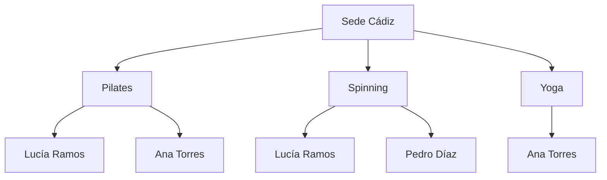
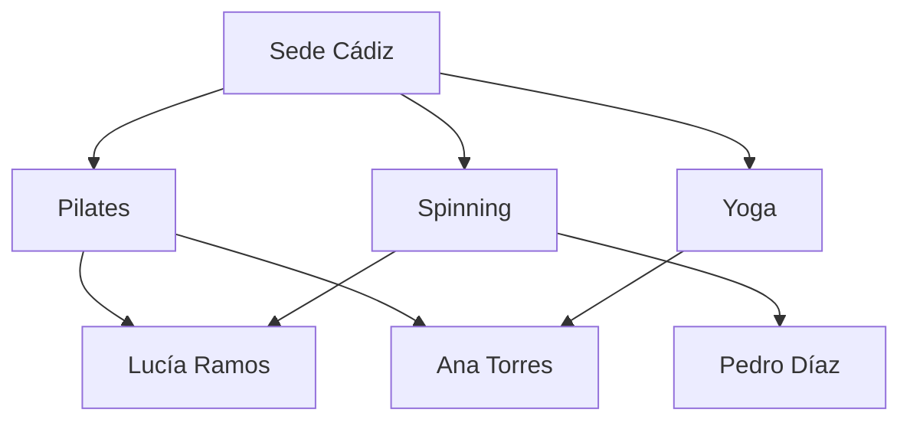

# UD01 - Actividades
## Centros Deportivos Atlántico

| | |
|---|---|
| **Ciclo formativo** | 1º Desarrollo de Aplicaciones Web (DAW) |
| **Módulo profesional** | 0484 · Bases de Datos |
| **Unidad didáctica** | UD1 · Conceptos básicos · Modelos de bases de datos y arquitectura cliente-servidor |
| **Resultado de aprendizaje** | RA1. Reconoce los elementos de las bases de datos, analizando sus funciones y valorando la utilidad de los sistemas gestores. |
| **Criterios de evaluación** | RA1.a · RA1.b · RA1.c · RA1.d · RA1.e · RA1.f · RA1.g · RA1.h · RA1.i · RA1.j |


---

## 1. Objetivo de la actividad

El objetivo de esta actividad es que **apliques** los contenidos de la unidad a un caso realista. No se trata de reproducir definiciones, sino de demostrar que sabes **analizar** un sistema de información, **detectar** sus problemas, **proponer** soluciones y **justificar** tus decisiones técnicas.

---

## 2. Descripción del caso

**Centros Deportivos Atlántico** es una cadena de gimnasios con tres sedes en la provincia de Cádiz: **Cádiz**, **Jerez** y **San Fernando**. Cuenta con unos 1.800 socios.

### 3.1. Situación actual

Cada sede dispone de un ordenador en recepción donde se guarda la información en **ficheros independientes**. La sede de Cádiz utiliza ficheros de texto con campos de longitud fija; la de Jerez, una hoja de cálculo; y la de San Fernando, un fichero de texto con los campos en otro orden. Hay programas sencillos, escritos hace años por un informático externo, que leen estos ficheros para emitir los recibos mensuales.

Los socios pueden contratar tres tarifas: **Básica** (una sede), **Premium** (una sede con clases ilimitadas) y **Multisede** (acceso a las tres sedes).

**Extracto del fichero `SOCIOS` · Sede Cádiz**

| Nº_SOCIO | DNI | NOMBRE | APELLIDOS | DIRECCIÓN | CP | TELÉFONO | IBAN | TARIFA | PRECIO |
|---|---|---|---|---|---|---|---|---|---|
| C-014 | 31234567A | Lucía | Ramos Gil | C/ Sopranis, 12 | 11005 | 600111222 | ES12 **** 3456 | Multisede | 45 € |
| C-015 | 44556677B | Pedro | Díaz Mora | Av. Andalucía, 3 | 11008 | 600333444 | ES98 **** 1122 | Básica | 30 € |
| C-016 | 77889900C | Ana | Torres Vela | C/ Ancha, 7 | 11001 | 600555666 | ES45 **** 7788 | Básica | 32 € |

**Extracto del fichero `SOCIOS` · Sede Jerez**

| Nº_SOCIO | DNI | NOMBRE | APELLIDOS | DIRECCIÓN | CP | TELÉFONO | IBAN | TARIFA | PRECIO |
|---|---|---|---|---|---|---|---|---|---|
| J-102 | 31234567A | Lucía | Ramos Gil | C/ Larga, 40 | 11402 | 600111222 | ES12 **** 3456 | Multisede | 45 € |

**Extracto del fichero `CLASES` · Sede Cádiz**

| COD_CLASE | NOMBRE | DÍA Y HORA | MONITOR | AFORO | PLAZAS_LIBRES |
|---|---|---|---|---|---|
| PIL-1 | Pilates | Lunes 18:00 | Marta Gómez | 15 | 4 |
| SPI-1 | Spinning | Miércoles 19:00 | Andrés Vela | 20 | 1 |
| YOG-1 | Yoga | Jueves 10:00 | Marta Gómez | 12 | 6 |

**Extracto del fichero `RESERVAS` · Sede Cádiz**

```
Nº_SOCIO | NOMBRE_SOCIO | CLASE_1, DÍA_HORA_1, MONITOR_1          | CLASE_2, DÍA_HORA_2, MONITOR_2
C-014    | Lucía Ramos  | Pilates, Lunes 18:00, Marta Gómez       | Spinning, Miércoles 19:00, Andrés Vela
C-015    | Pedro Díaz   | Spinning, Miércoles 19:00, Andrés Vela  | —
C-016    | Ana Torres   | Pilates, Lunes 18:00, Marta Gómez       | Yoga, Jueves 10:00, Marta Gómez
C-999    | (sin nombre) | Yoga, Jueves 10:00, Marta Gómez         | —
```

### 3.2. Incidencias registradas el último trimestre

| Nº | Incidencia |
|---|---|
| **I1** | Lucía Ramos comunicó en la sede de Cádiz su cambio de domicilio. Un mes después, la sede de Jerez le sigue enviando la correspondencia a su dirección antigua. |
| **I2** | Un miércoles, la recepcionista del mostrador y la que atendía el teléfono asignaron **a la vez** la última plaza de Spinning. A la clase acudieron 21 personas para un aforo de 20. |
| **I3** | La gerente pidió un listado de los socios de las tres sedes con código postal 11005. El informático respondió que necesitaba **escribir un programa nuevo** y antes **unificar los formatos** de los tres ficheros, y presupuestó dos semanas de trabajo. |
| **I4** | Los monitores utilizan el ordenador de recepción para consultar sus clases y **pueden ver el IBAN** de todos los socios. |
| **I5** | En el fichero `RESERVAS` figura una reserva del socio **C-999**, que no existe en el fichero `SOCIOS`. |
| **I6** | Para poder guardar teléfonos con prefijo internacional se amplió la longitud del campo `TELÉFONO`. Al día siguiente **dejó de funcionar el programa de recibos**. |
| **I7** | Dos socios con la misma tarifa Básica pagan precios distintos (30 € y 32 €), sin que nadie sepa cuál es el correcto. |

### 3.3. Plan de futuro

La dirección ha aprobado un plan con los siguientes objetivos:

- **Sustituir los ficheros por un Sistema Gestor de Bases de Datos** relacional.
- Lanzar una **aplicación móvil** para que los socios consulten horarios y reserven clases.
- **Expandirse en tres años a 20 sedes** en tres zonas: **Cádiz**, **Sevilla** y **Málaga**, con unos 15.000 socios.
- **Analizar el histórico** de reservas y accesos para decidir horarios, clases y la ubicación de nuevas sedes.

Personas implicadas en el proyecto:

- **La gerente**, que decide qué información necesita la empresa.
- **Un técnico de sistemas** contratado para instalar, configurar y administrar la base de datos.
- **Una empresa de desarrollo** que programará la aplicación móvil.
- **Las recepcionistas**, **el personal de administración**, **los monitores** y **los socios**.

---

## 3. Actividades

### Actividad 1. Análisis del sistema actual de ficheros · RA1.a 

### Actividad 1. Análisis del sistema actual de ficheros · RA1.a 

**1.1.** Para **cada incidencia** (I1 a I7), indica qué problema propio de los sistemas de ficheros la ha provocado y **explica por qué** la organización actual la hace posible. Debes señalar los **datos concretos** de los extractos que lo demuestran.

| Incidencia | Problema de los sistemas de ficheros | Explicación aplicada al caso (con datos de los extractos) |
|---|---|---|
| I1 |Redundancia &rarr; inconscistencia (mismo dato en varios sitios) |Lucía Ramos aparece en los ficheros de Cádiz y Jerez con el mismo DNI (31234567A), pero tiene direcciones diferentes. Al cambiar su domicilio en Cádiz, el fichero de Jerez no se actualiza porque cada sede guarda sus propios datos.|
| I2 |Concurrencia &rarr; acceso simultaneo| Dos recepcionistas asignaron simultáneamente la última plaza de Spinning. Como los ficheros no controlan los accesos simultáneos, ambas operaciones se realizaron y acudieron 21 personas cuando el aforo era de 20. |
| I3 |Acceso difícil &rarr; Consultas no previstas| Cada sede utiliza un formato diferente: Cádiz usa ficheros de texto con longitud fija, Jerez una hoja de cálculo y San Fernando otro orden de campos. Por eso, el informático necesita modificar los programas y unificar los formatos para obtener el listado. |
| I4 |Seguridad &rarr; Acceso no controlado (dan todos los datos) | Los monitores pueden consultar los ordenadores de recepción y ver el IBAN de todos los socios. No existe un control adecuado para limitar qué información puede consultar cada usuario. |
| I5 |Integridad &rarr; Restricciones difíciles de aplicar (solo datos coherentes) | En el fichero RESERVAS aparece el socio C-999, que no existe en el fichero SOCIOS. Esto ocurre porque los ficheros independientes no comprueban que las reservas pertenezcan a socios registrados. |
| I6 |Dependencia &rarr; Los cambios físicos afectan a los programas | Al ampliar la longitud del campo TELÉFONO para admitir prefijos internacionales, el programa de recibos dejó de funcionar porque estaba diseñado para una estructura y longitud concretas.. |
| I7 |Redundancia &rarr; Incoscistencia| Dos socios con tarifa Básica pagan precios diferentes: Pedro Díaz paga 30 € y Ana Torres 32 €. Esto sucede porque los precios se guardan directamente en los registros y no existe un control centralizado que garantice que la misma tarifa tenga un precio correcto. |

**1.2.** El fichero `RESERVAS` repite en cada registro el nombre del socio, el día, la hora y el monitor de cada clase.

- **a)** Explica qué consecuencias tiene esta organización cuando, por ejemplo, Andrés Vela deja de impartir Spinning.

Si Andrés Vela deja de impartir Spinning, habría que modificar todos los registros del fichero RESERVAS donde aparece su nombre. Si se olvida alguno, existirían datos diferentes sobre el monitor que imparte la clase.

Esto provoca redundancia e inconsistencia de los datos, además de dificultar su mantenimiento.

- **b)** Propón una **reorganización en varios ficheros** que elimine las repeticiones, indicando los campos de cada uno y el **campo clave**.
Para evitar repetir información, dividiría los datos en los siguientes ficheros:

| Fichero | Campos | Campo clave |
|---|---|---|
| SOCIOS | Nº_SOCIO, DNI, NOMBRE, APELLIDOS, DIRECCIÓN, CP, TELÉFONO, IBAN, COD_TARIFA | Nº_SOCIO |
| CLASES | COD_CLASE, NOMBRE, DÍA, HORA, COD_MONITOR, AFORO | COD_CLASE |
| MONITORES | COD_MONITOR, NOMBRE, APELLIDOS, TELÉFONO | COD_MONITOR |
| TARIFAS | COD_TARIFA, NOMBRE_TARIFA, PRECIO | COD_TARIFA |
| RESERVAS | COD_RESERVA, Nº_SOCIO, COD_CLASE, FECHA_RESERVA | COD_RESERVA |

Así, cada información se almacena una sola vez y los ficheros se relacionan mediante sus campos clave.

Por ejemplo, si Andrés Vela deja de impartir Spinning, solo habría que modificar la información correspondiente en el fichero de clases o monitores, sin tener que cambiar todas las reservas históricas.

- **c)** Define el **formato de registro** del nuevo fichero `SOCIOS` (campo, nombre, tipo y longitud) e indica su campo clave. Justifica por qué no has elegido `NOMBRE` como clave.
Propongo el siguiente formato:

| Campo | Nombre | Tipo de dato | Longitud |
|---|---|---|---|
| Nº_SOCIO | Número de socio | Alfanumérico | 10 |
| DNI | Documento de identidad | Alfanumérico | 9 |
| NOMBRE | Nombre | Texto | 30 |
| APELLIDOS | Apellidos | Texto | 50 |
| DIRECCIÓN | Dirección | Texto | 100 |
| CP | Código postal | Numérico | 5 |
| TELÉFONO | Teléfono | Alfanumérico | 15 |
| IBAN | Cuenta bancaria | Alfanumérico | 34 |
| COD_TARIFA | Código de tarifa | Alfanumérico | 10 |

**Campo clave elegido: Nº_SOCIO.**

He elegido Nº_SOCIO porque identifica de forma única a cada socio y permite diferenciar a personas que puedan tener el mismo nombre o apellidos.

No he elegido NOMBRE como clave porque varias personas pueden llamarse igual, por lo que no garantiza que cada registro sea único.

---

### Actividad 2. Utilidad de un Sistema Gestor de Bases de Datos · RA1.d 

**2.1.** Explica cómo resolvería un SGBD **cada una de las incidencias** de la actividad 1. Relaciona cada solución con la **ventaja concreta** del SGBD que la hace posible.

| Incidencia | Solución mediante un SGBD | Ventaja del SGBD |
|---|---|---|
| I1 | Todos los datos de Lucía estarían almacenados en una única base de datos compartida por las sedes. Al modificar su dirección, el cambio estaría disponible para todas. | Reducción de la redundancia y mejora de la consistencia. |
| I2 | El SGBD controlaría las operaciones simultáneas mediante transacciones y mecanismos de bloqueo. Así, solo una persona podría ocupar la última plaza. | Control de concurrencia. |
| I3 | Se podrían realizar consultas directamente sobre una base de datos común, sin tener que crear programas diferentes para cada formato. | Independencia de los datos y facilidad de consulta. |
| I4 | Se crearían permisos y usuarios diferentes para cada trabajador. Los monitores podrían consultar sus clases sin acceder a los datos bancarios. | Seguridad y control de acceso. |
| I5 | Se establecerían claves primarias y claves ajenas para impedir que se creen reservas de socios que no existen. | Integridad de los datos. |
| I6 | Los cambios en la estructura de la base de datos se gestionarían desde el SGBD, reduciendo la dependencia de los programas respecto a los ficheros. | Independencia entre datos y aplicaciones. |
| I7 | Los precios se almacenarían en una tabla centralizada de tarifas. Todos los socios con la misma tarifa tendrían asociado el precio correspondiente. | Consistencia y control de los datos. |

**2.2.** La gerente se pregunta si el cambio "merece la pena". Analiza qué **inconvenientes** tendrá la implantación de un SGBD **para esta empresa en concreto** y emite una recomendación razonada.

La implantación de un SGBD también tiene algunos inconvenientes para Centros Deportivos Atlántico:

- **Coste económico:** será necesario invertir dinero en el software, los equipos informáticos y la posible contratación de personal especializado.
- **Formación:** los trabajadores tendrán que aprender a utilizar el nuevo sistema.
- **Complejidad:** será necesario diseñar correctamente la base de datos, configurarla y mantenerla.
- **Migración de datos:** habrá que trasladar la información de los tres formatos actuales a la nueva base de datos, comprobando que no se pierdan datos.
- **Mantenimiento:** será necesario realizar copias de seguridad, actualizaciones y tareas de administración.
- **Dependencia del sistema:** si el servidor o la base de datos dejan de funcionar, podría afectar al trabajo de todas las sedes.

**Mi recomendación:**

Recomendaría implantar un SGBD relacional porque las ventajas son mucho mayores que los inconvenientes en esta empresa.

Actualmente tiene tres sedes y unos 1.800 socios, pero su objetivo es crecer hasta 20 sedes y 15.000 socios. Además, quiere desarrollar una aplicación móvil para realizar reservas y analizar el histórico de accesos y clases.

Un SGBD permitiría centralizar la información, evitar duplicidades, controlar las reservas simultáneas y mejorar la seguridad de los datos.

Por tanto, aunque la implantación supone un coste inicial y requiere formación, considero que es una inversión necesaria para mejorar la organización y permitir el crecimiento de la empresa.

****2.3.** Un monitor que trabaja como entrenador personal por su cuenta, con 12 clientes, guarda en un fichero de texto la fecha y el tipo de sesión de cada cliente. ¿Le recomendarías un SGBD? Justifica tu respuesta comparándola con la de Centros Deportivos Atlántico.
No recomendaría implantar un SGBD al entrenador personal que trabaja por su cuenta con solamente 12 clientes.**

En su caso, un fichero de texto puede ser suficiente para guardar las fechas y los tipos de sesiones de cada cliente, ya que maneja poca información y no necesita que varias personas accedan a ella simultáneamente.

Un SGBD supondría una mayor complejidad, costes y tiempo de mantenimiento que posiblemente no compensarían sus ventajas.

En cambio, para Centros Deportivos Atlántico sí recomendaría un SGBD porque tiene tres sedes, unos 1.800 socios, varios trabajadores que necesitan acceder a la información y planes de expansión hasta 20 sedes.


---

### Actividad 3. Elementos de un SGBD · RA1.e

**3.1.** Una vez implantado el SGBD, se producen las situaciones siguientes. Para cada una, indica ***qué elemento del SGBD interviene*** (núcleo, DDL, DML, DCL, utilidades o diccionario de datos), ***qué tipo de usuario la realiza*** (administrador de datos, administrador de la base de datos, programador de aplicaciones, usuario final o ninguno si es automática) y ***justifica*** brevemente tu respuesta.

| Nº | Situación | Elemento del SGBD | Tipo de usuario | Justificación |
|---|---|---|---|---|
| 1 |	La gerente decide que a partir de ahora se registrará un teléfono de emergencia de cada socio. El cambio se aplicará modificando la estructura de la tabla SOCIOS. | DDL (mpdifica la estrucutra) | Administrador de la base de datos | Modificar la estructura de una tabla (por ejemplo con `ALTER TABLE SOCIOS ADD ...`) es definir estructuras, y eso es el lenguaje de definición de datos. La gerente decide qué información necesita la empresa, y el técnico de sistemas, que administra la base de datos, es quien ejecuta el cambio. |
| 2 | Se ejecuta `CREATE TABLE RESERVAS (...)`. | DDL | Administrador de la base de datos | `CREATE` sirve para definir estructuras (tablas, campos, claves), y esa tarea corresponde al lenguaje de definición de datos. Lo hace el técnico de sistemas, que es quien diseña y administra la base de datos. |
| 3 | Una recepcionista consulta, desde el programa de recepción, qué clases del jueves tienen plazas libres. | DML (modifica datos) | Usuario final | Consultar datos (`SELECT`) es manipulación de datos. La recepcionista no escribe SQL: usa un programa que lo hace por ella, así que es usuario final. |
| 4 | Se ejecuta `GRANT SELECT ON CLASES TO monitores;` | DCL (da o quita permisos) | Administrador de la base de datos | `GRANT` concede permisos, y eso es control de acceso, que es lo que hace el lenguaje de control de datos. Solo el administrador decide quién puede ver qué. |
| 5 | El SGBD rechaza una reserva porque el número de socio no existe. | Núcleo (SGBD lo hace solo) | Ninguno (automática) | El núcleo es quien comprueba las restricciones de integridad (aquí la clave externa Nº_SOCIO → SOCIOS) cada vez que se inserta un dato. Nadie interviene en ese momento: lo hace el SGBD solo. |
| 6 | Dos recepcionistas intentan asignar a la vez la última plaza de Spinning; el SGBD solo acepta una de las dos operaciones. | Núcleo | Ninguno (automática) | El control de la concurrencia (transacciones y bloqueos) lo realiza el núcleo. Es automático y evita que ocurra lo de la incidencia I2. |
| 7 | El técnico consulta qué tablas existen, qué campos tienen y qué usuarios tienen permisos sobre ellas. | Diccionario de datos (Consulta inf sobre la BBDD) | Administrador de la base de datos | El diccionario de datos guarda los metadatos: tablas, campos, tipos, usuarios y permisos. Es lo que consulta el técnico para administrar la base de datos. |
| 8 | Administración genera el informe mensual de cuotas con un asistente gráfico, sin escribir código. | Utilidades (Es una herramienta) | Usuario final | Los asistentes y generadores de informes son herramientas (utilidades) que acompañan al SGBD. Las usa personal de administración que no sabe programar, por eso es usuario final. |
| 9 | Se cargan en la nueva base de datos los ficheros antiguos de las tres sedes. | Utilidades | Administrador de la base de datos | La importación o carga de datos es una utilidad del SGBD. La hace el técnico, porque tiene que unificar los tres formatos y comprobar que no se pierda nada. |
| 10 | La empresa de desarrollo programa la pantalla de reservas de la app, que resta una plaza libre cada vez que un socio reserva. | DML | Programador de aplicaciones | Restar una plaza (`UPDATE`) e insertar la reserva (`INSERT`) son operaciones de manipulación de datos. Las programa la empresa de desarrollo dentro de la aplicación, así que es programador de aplicaciones. |

**3.2.** Analiza los cambios siguientes. Para cada uno, indica **qué nivel de la arquitectura** de la base de datos se modifica (interno, conceptual o externo), **qué tipo de independencia** de datos interviene (si procede) y **qué programas o usuarios se ven afectados**.

| Cambio | Nivel modificado | Independencia | ¿A quién afecta? |
|---|---|---|---|
| a) El técnico reorganiza el almacenamiento de SOCIOS y crea un índice sobre el DNI para acelerar las búsquedas. | Interno (cambia como se guarda) | Independencia física | No afectan al nivel conceptual |
| b) Se añade el campo TELEFONO_EMERGENCIA a SOCIOS. | Conceptual (cambia datos y su relacion) | Independencia lógica | Solo a los programas o usuarios que necesiten el nuevo campo. |
| c) Se crea una vista para los monitores que muestra solo el nombre del socio y sus clases. | Externo o vistas (cambia lo que ve el usuario) | Ninguna independencia (NO AFECTA) | A los monitores, que solo verán lo que incluye la vista. |
| d) Se elimina el campo FAX de SOCIOS, que solo usaba el antiguo programa de envío de cartas. | Conceptual | Independencia lógica | Solo afecta a los ususarios que anteriormente puedieran ver este campo |

**Por último, compara el cambio *b* con la incidencia **I6** y explica qué ha cambiado gracias al SGBD.**

En la incidencia I6, al ampliar la longitud del campo TELÉFONO, el programa de recibos dejó de funcionar porque dependía directamente de la estructura y del formato de los ficheros: sabía en qué posición y con qué longitud estaba cada dato.

Con un SGBD, los datos y los programas están más separados. Los programas piden los datos al SGBD (por ejemplo con SQL) y es el SGBD quien sabe cómo están guardados. Por eso se puede modificar la estructura de la base de datos sin tener que cambiar necesariamente todas las aplicaciones.

Por ejemplo, al añadir el campo TELEFONO_EMERGENCIA, el programa de recibos puede seguir funcionando sin tocar nada, porque solo pide los campos que necesita. Esto es posible gracias a la independencia lógica de los datos que proporciona el SGBD.

---

### Actividad 4. Modelos de datos · RA1.b

Utiliza los datos de reservas de la sede de Cádiz (excluyendo la reserva errónea de C-999):

- Lucía Ramos → Pilates y Spinning.
- Pedro Díaz → Spinning.
- Ana Torres → Pilates y Yoga.

**4.1.** **Modelo jerárquico.** Representa la información en forma de árbol, tomando como raíz la *Sede Cádiz*, después las *clases* y, por debajo, los *socios*. Indica qué datos aparecen **duplicados** y explica por qué este modelo obliga a ello.



En el modelo jerárquico cada hijo solo puede tener **un padre**. Como Lucía y Ana están en dos clases, hay que copiar sus datos debajo de cada una, lo que genera redundancia.

**4.2.** **Modelo en red.** Representa la misma información como red. Señala qué nodos tienen **más de un padre** y explica qué ventaja supone respecto al modelo jerárquico.




**4.3.** **Modelo relacional.**

- **a)** Diseña las tablas `SOCIOS`, `CLASES` y `RESERVAS` con sus campos e indica la **clave primaria** y las **claves externas** de cada una.

| Tabla | Campos | Clave primaria | Claves externas |
|---|---|---|---|
| SOCIOS | Nº_SOCIO, DNI, NOMBRE, APELLIDOS, TELÉFONO, TARIFA | Nº_SOCIO | Ninguna |
| CLASES | COD_CLASE, NOMBRE, DIA_HORA, MONITOR, AFORO, PLAZAS_LIBRES | COD_CLASE | Ninguna |
| RESERVAS | COD_RESERVA, Nº_SOCIO, COD_CLASE | COD_RESERVA | Nº_SOCIO → SOCIOS, COD_CLASE → CLASES |

- **b)** Rellena las tres tablas con los datos anteriores.

**SOCIOS**

| Nº_SOCIO | DNI | NOMBRE | APELLIDOS | TELÉFONO | TARIFA |
|---|---|---|---|---|---|
| C-014 | 31234567A | Lucía | Ramos Gil | 600111222 | Multisede |
| C-015 | 44556677B | Pedro | Díaz Mora | 600333444 | Básica |
| C-016 | 77889900C | Ana | Torres Vela | 600555666 | Básica |

**CLASES**

| COD_CLASE | NOMBRE | DIA_HORA | MONITOR | AFORO | PLAZAS_LIBRES |
|---|---|---|---|---|---|
| PIL-1 | Pilates | Lunes 18:00 | Marta Gómez | 15 | 4 |
| SPI-1 | Spinning | Miércoles 19:00 | Andrés Vela | 20 | 1 |
| YOG-1 | Yoga | Jueves 10:00 | Marta Gómez | 12 | 6 |

**RESERVAS**

| COD_RESERVA | Nº_SOCIO | COD_CLASE |
|---|---|---|
| R-1 | C-014 | PIL-1 |
| R-2 | C-014 | SPI-1 |
| R-3 | C-015 | SPI-1 |
| R-4 | C-016 | PIL-1 |
| R-5 | C-016 | YOG-1 |

La reserva de C-999 no se puede insertar porque ese socio no existe en `SOCIOS`. La clave externa lo impide, y así se evita el problema de la incidencia I5.

- **c)** Explica por qué es necesaria la tabla `RESERVAS` y por qué en ella un mismo valor de clave externa puede repetirse.

La tabla `RESERVAS` es necesaria porque entre socios y clases hay una relación N:M, ya que un socio puede reservar varias clases y una clase tiene varios socios. En el modelo relacional esto no se puede guardar directamente en `SOCIOS` o `CLASES` sin repetir datos, así que se crea una tabla intermedia que une las dos.

Una clave externa puede repetirse porque no identifica el registro, solo apunta a otra tabla. Por ejemplo, C-014 aparece dos veces en `RESERVAS` porque Lucía tiene dos reservas, y SPI-1 aparece dos veces porque esa clase tiene dos socios. Lo que no puede repetirse es la clave primaria (COD_RESERVA).

**4.4.** Justifica cuál de los tres modelos es el adecuado para Centros Deportivos Atlántico. Indica además **una parte del sistema** de la empresa (actual o futura) en la que una estructura jerárquica sí tendría sentido y por qué.

El modelo adecuado es el **relacional**, por varias razones:

- Los datos se guardan en tablas, que son fáciles de entender y de consultar.
- Permite relaciones N:M (socios–clases) con tablas intermedias y sin duplicar datos.
- Con claves primarias y externas garantiza la integridad (por ejemplo, evita reservas de socios inexistentes).
- Es el modelo de los SGBD más usados y soporta bien el crecimiento a 20 sedes y 15.000 socios.
- Se pueden hacer consultas nuevas con SQL sin programar cada vez, como pedía la gerente en la I3.

El jerárquico duplicaría datos, y el de red es más complicado de manejar y de mantener.

Una estructura jerárquica sí tendría sentido en la **organización territorial de la empresa**: Empresa &rarr; Zona (Cádiz, Sevilla, Málaga) &rarr; Sede &rarr; Salas. Cada elemento pertenece a un único padre (una sede está en una sola zona y una sala en una sola sede), así que no hay datos duplicados.

---

### Actividad 5. Clasificación de los sistemas gestores · RA1.f

**5.1.** Clasifica los siguientes sistemas completando la tabla. Si un sistema **no es un SGBD**, indícalo y explica el motivo.

| Sistema | ¿Es un SGBD? | Modelo de datos | Ubicación de la información (centralizada / distribuida) | Usuarios (uno / varios simultáneos) | Configuración (monoequipo / cliente-servidor / con servidor de aplicaciones / distribuida) |
|---|---|---|---|---|---|
| A. El sistema actual de cada sede, con ficheros en el ordenador de recepción. | **No.** Es un sistema de ficheros: no hay software que gestione los datos, solo programas que leen ficheros. | Ninguno (no sigue un modelo de datos) | Centralizada en el ordenador de cada sede, sin conexión con las demás | Uno (sin control de concurrencia) | Monoequipo |
| B. El entrenador personal de la actividad 2.3 instala SQLite en su portátil para gestionar a sus clientes. | Sí | Relacional | Centralizada | Uno | Monoequipo |
| C. Un SGBD jerárquico, similar a IBM IMS, instalado en un servidor central al que se conectan varios terminales. | Sí | Jerárquico | Centralizada | Varios simultáneos | Cliente-servidor (servidor central con terminales) |
| D. MySQL instalado en un servidor de la sede de Cádiz, al que se conectan las recepciones de las tres sedes. | Sí | Relacional | Centralizada (en Cádiz) | Varios simultáneos | Cliente-servidor |
| E. La app móvil se comunica con un servidor de aplicaciones que, a su vez, consulta una base de datos PostgreSQL. | Sí (PostgreSQL) | Relacional | Centralizada | Varios simultáneos | Con servidor de aplicaciones (3 capas) |
| F. Tras la expansión, cada zona tiene su propio servidor PostgreSQL y el conjunto funciona como una única base de datos. | Sí | Relacional | Distribuida | Varios simultáneos | Distribuida |

**5.2.** Los ficheros de las tres sedes ya están repartidos en tres ordenadores distintos. ¿Puede considerarse el sistema actual una **base de datos distribuida**? Justifica tu respuesta.

**No**, no puede considerarse una base de datos distribuida. Por estas razones:

- Los ficheros no están gestionados por un SGBD, así que ni siquiera es una base de datos.
- Cada sede tiene sus datos aislados, con formatos distintos (texto de longitud fija, hoja de cálculo, otro orden de campos), y los ordenadores no están conectados para funcionar como un conjunto.
- En una base de datos distribuida los datos están repartidos en varios equipos conectados en red, pero el usuario los ve como **una única base de datos**. Aquí no pasa eso: para listar los socios con CP 11005 de las tres sedes hacen falta dos semanas de trabajo (I3), y Lucía está duplicada en dos sedes con datos distintos (I1).

Tener la información en varios ordenadores no basta para que sea distribuida. Hace falta un SGBD que coordine los equipos.

---

### Actividad 6. Ubicación de la información y bases de datos distribuidas · RA1.c · RA1.g

**6.1.** Para afrontar la expansión a 20 sedes, el técnico plantea cuatro opciones. Completa la tabla **aplicándola al caso**:

| Opción | ¿Dónde se encuentra físicamente la información? | Ventaja principal para Atlántico | Inconveniente principal para Atlántico |
|---|---|---|---|
| 1. Cada sede con su propio SGBD en el ordenador de recepción (monoequipo). | En 20 ordenadores, uno por sede, cada uno con su propia base de datos. | Es barato y sencillo, y cada sede funciona sin depender de las demás ni de internet. | Vuelven los problemas de los ficheros: datos duplicados y distintos (como Lucía en Cádiz y Jerez). Los socios Multisede no funcionan bien y no hay visión global para analizar el histórico. Además habría que mantener y hacer copias de 20 sitios. |
| 2. Un único servidor central en Cádiz al que se conectan todas las sedes (cliente-servidor). | En un solo servidor, en Cádiz. | Hay una sola copia de los datos, sin duplicados, y es fácil de administrar, proteger y hacer copias. Los socios Multisede se atienden sin problema. | Es un punto único de fallo: si el servidor cae, las 20 sedes y la app se quedan sin servicio. También puede saturarse con 15.000 socios en hora punta y ser lento para Sevilla y Málaga. |
| 3. Un servidor en cada zona (Cádiz, Sevilla y Málaga) formando una base de datos distribuida. | Repartida en tres servidores, uno por zona, conectados en red. | Cada zona trabaja con un servidor cercano y rápido. Se reparte la carga, y si cae un servidor las otras zonas siguen funcionando. | Es más complejo y caro. Hay que sincronizar los datos entre servidores, sobre todo para los Multisede, y se necesita personal técnico más cualificado. |
| 4. Cualquiera de las anteriores con un servidor de aplicaciones intermedio para la app móvil. | Los datos siguen donde estén según la opción elegida (1, 2 o 3). El servidor de aplicaciones es una capa nueva entre la app y la base de datos. | La app no accede directamente a la base de datos, lo que mejora la seguridad. Las reglas de reserva se programan en un solo sitio y se aguantan mejor muchos móviles a la vez. | Es un servidor más que pagar, programar y mantener, y si falla la app deja de funcionar. |

**6.2.** Describe, paso a paso, qué ocurre desde que una socia pulsa *Reservar* en la app hasta que recibe la confirmación. Indica en qué **capa** (presentación, lógica o datos) se produce cada paso y en qué capa debe comprobarse que quedan plazas libres. Justifica esto último.

| Paso | Qué ocurre | Capa |
|---|---|---|
| 1 | La socia elige la clase y pulsa *Reservar* en la app. | Presentación |
| 2 | La app envía la petición (socia + clase) por internet al servidor de aplicaciones. | Presentación → Lógica |
| 3 | El servidor comprueba que la socia está identificada y que su tarifa le permite reservar en esa sede. | Lógica |
| 4 | El servidor comprueba si quedan plazas libres y pide los datos al SGBD. | Lógica |
| 5 | El SGBD ejecuta una transacción: bloquea la clase, comprueba PLAZAS_LIBRES > 0, resta 1 plaza y guarda la reserva en `RESERVAS`. | Datos |
| 6 | El SGBD devuelve el resultado (OK o error) al servidor de aplicaciones. | Datos → Lógica |
| 7 | El servidor prepara la respuesta: "Reserva confirmada" o "Clase completa". | Lógica |
| 8 | La app muestra el mensaje a la socia. | Presentación |

**¿Dónde se comprueba que quedan plazas?** Se decide en la **capa de lógica** (es una regla de negocio), pero se garantiza en la **capa de datos**, con la transacción y el bloqueo del SGBD.

**Justificación:**

- No puede hacerse solo en la capa de presentación, porque la app puede tener información desactualizada, por ejemplo mostrar 1 plaza libre cuando otra socia ya la ha cogido. Además, el código del móvil se puede manipular.
- Si solo se comprobara en la lógica sin transacción, dos socias podrían reservar a la vez la última plaza y pasaría lo de la incidencia I2 (21 personas para un aforo de 20). Por eso el SGBD debe asegurar que la operación de comprobar y restar sea atómica.

**6.3.** Analiza cómo responderían la opción 2 (centralizada) y la opción 3 (distribuida) ante estas situaciones:

- **a)** Un lunes a las 19:00, hora punta, se produce un corte eléctrico en el edificio donde está el servidor de Cádiz.

  - **Opción 2 (centralizada):** como todo está en ese servidor, se paralizan **todas las sedes** y la app. Nadie puede reservar ni consultar datos hasta que vuelva la luz, y en hora punta eso es un problema grave. Habría que tener SAI (batería) o un servidor de respaldo.
  - **Opción 3 (distribuida):** solo se ve afectada la zona de Cádiz. Sevilla y Málaga siguen funcionando con sus servidores. Si además hay réplica de los datos de Cádiz en otro servidor, incluso se podría seguir dando servicio.

- **b)** Lucía Ramos, con tarifa Multisede y dada de alta en Cádiz, reserva una clase en una sede de Málaga. Explica qué debe ocurrir para que la socia **perciba un único sistema** y qué dificultad técnica supone.

  - **Opción 2:** no hay problema, porque todo está en el mismo servidor. Se consulta a Lucía y se reserva la clase de Málaga en la misma base de datos.
  - **Opción 3:** el servidor de Málaga no tiene los datos de Lucía, que están en el de Cádiz. Para que ella lo vea como un único sistema, el SGBD distribuido debe tener **transparencia de ubicación**: buscar los datos donde estén (consultando al servidor de Cádiz) sin que Lucía ni la app sepan en qué servidor están.
  - **Dificultad técnica:** hay que coordinar transacciones entre dos servidores (comprobar la tarifa en Cádiz y restar plaza en Málaga) de forma que se hagan las dos cosas o ninguna. Si falla la conexión entre ambos a mitad de la operación, los datos pueden quedar inconsistentes. Además, la comunicación entre servidores añade retardo.

**6.4.** Recomienda razonadamente una de las opciones para la empresa dentro de tres años, valorando tanto sus ventajas como sus inconvenientes.

Recomiendo la **opción 3 (servidor por zona, base de datos distribuida) junto con la opción 4 (servidor de aplicaciones para la app móvil)**.

**Ventajas:**

- La empresa se organizará en tres zonas (Cádiz, Sevilla y Málaga), y la mayoría de los socios irán a sedes de su zona. Por eso tiene sentido que sus datos estén en el servidor más cercano, que será más rápido.
- Con 20 sedes y 15.000 socios, un único servidor sería un punto único de fallo. Si cae, se para toda la empresa y la app.
- Si falla un servidor, las otras dos zonas siguen funcionando.
- El servidor de aplicaciones protege la base de datos (la app no se conecta directamente) y centraliza la lógica de las reservas, lo que ayuda a controlar las reservas simultáneas.
- Al ser un SGBD, se puede analizar el histórico de reservas y accesos de toda la empresa para decidir horarios, clases y nuevas sedes.

**Inconvenientes:**

- Es más caro y complejo que un servidor único, y habrá que contratar o formar a técnicos para administrarlo.
- Los socios Multisede que usen sedes de otra zona obligarán a coordinar servidores, con más retardo y más riesgo de inconsistencias.
- El servidor de aplicaciones es un elemento más que mantener.

Descarto la opción 1 porque repite los problemas actuales de los ficheros (datos duplicados y sin visión global). Descarto la opción 2 por el riesgo de que todo dependa de un único servidor. Aun así, el coste y la complejidad de la opción 3 compensan por la seguridad y el crecimiento que da a la empresa.

---

---

### Actividad 7. Reparto de la información entre servidores (fragmentación) · RA1.h

Cuando se elige una base de datos distribuida, hay que decidir **qué parte de la información se guarda en cada servidor**. A esta división se la denomina **fragmentación**, y puede hacerse de dos formas:

- **Repartir registros (filas)** de una tabla según un criterio, como en el ejemplo de Netflix de la unidad, donde cada servidor regional guarda los datos de los usuarios de su zona.
- **Repartir campos (columnas)** de una misma tabla en servidores distintos, de modo que cada servidor guarda solo una parte de la información de cada registro.

Además, algunas tablas pueden **replicarse**, es decir, guardarse **completas en todos los servidores**.

Tras la expansión, la tabla `SOCIOS` tendría este aspecto (extracto):

| Nº_SOCIO | DNI | NOMBRE | SEDE_ALTA | ZONA | TELÉFONO | IBAN | TARIFA | CUOTA |
|---|---|---|---|---|---|---|---|---|
| CA-014 | 31234567A | Lucía Ramos | Cádiz | Cádiz | 600111222 | ES12 **** 3456 | Multisede | 45 € |
| CA-015 | 44556677B | Pedro Díaz | Jerez | Cádiz | 600333444 | ES98 **** 1122 | Básica | 30 € |
| SE-201 | 12345678D | Javier Ruiz | Sevilla Nervión | Sevilla | 611222333 | ES33 **** 9900 | Premium | 55 € |
| SE-202 | 23456789E | Elena Mena | Dos Hermanas | Sevilla | 622333444 | ES71 **** 4455 | Básica | 30 € |
| MA-301 | 34567890F | Carmen Soto | Málaga Centro | Málaga | 633444555 | ES20 **** 6677 | Multisede | 45 € |
| MA-302 | 45678901G | Luis Peña | Marbella | Málaga | 644555666 | ES88 **** 2211 | Básica | 30 € |

**7.1.** Propón cómo repartir las tablas `SOCIOS`, `CLASES`, `RESERVAS` y `TARIFAS` entre los tres servidores de zona. Para cada tabla indica si la **fragmentarías por registros** (y con qué criterio) o si la **replicarías**, y justifica la decisión pensando en qué datos consulta cada sede con más frecuencia.

**7.2.** Aplica tu criterio al extracto anterior: indica qué registros de `SOCIOS` se almacenarían en cada servidor. Comprueba que ningún registro se pierde ni aparece en dos fragmentos.

**7.3.** El técnico propone además **separar por campos** la tabla `SOCIOS`: los datos bancarios y de cuota se guardarían en un servidor de administración especialmente protegido, y el resto en los servidores de zona.

- **a)** Indica qué campos tendría cada fragmento.
- **b)** ¿Qué campo debe aparecer **en ambos fragmentos** y por qué?
- **c)** Explica qué ventaja aporta esta separación en relación con la incidencia **I4**.

**7.4.** Con tu propuesta, ¿en qué servidor quedaría registrada la reserva que Lucía Ramos (Cádiz, Multisede) hace en Málaga? Analiza qué problema plantea y propón una solución.

---

### Actividad 8. Protección de datos · RA1.i

**8.1.** A partir de los campos de la tabla `SOCIOS`, identifica qué datos son **de carácter personal** e indica cuáles consideras **más delicados** y por qué.

**8.2.** Indica qué **normativa europea** de protección de datos, citada en los materiales de la unidad, debe cumplir Centros Deportivos Atlántico, y explica **con tus palabras** por qué le afecta.

**8.3.** Propón **al menos cuatro medidas técnicas** para proteger los datos de los socios, basadas en los contenidos de la unidad. Al menos una debe resolver la incidencia **I4** y otra debe aplicarse a la app móvil.

| Medida | Concepto de la unidad en el que se basa | Riesgo que evita en Atlántico |
|---|---|---|
| | | |

Incluye en una de las medidas la **sentencia DCL** que utilizarías, siguiendo el ejemplo de la unidad.

---

### Actividad 9. Análisis de datos para la toma de decisiones · RA1.j

En la unidad se han visto plataformas que guardan datos para **analizarlos**: el *microservicio Analytics* con su propia base de datos, los *historiales de visualización* o los *algoritmos de recomendación* de una plataforma de *streaming*.

- Utilizar los datos acumulados de una empresa para **apoyar la toma de decisiones** se denomina **inteligencia de negocio** (*Business Intelligence*, BI).
- Cuando el **volumen** de datos es tan grande, se genera **tan rápido** o es **tan variado** que las herramientas tradicionales no bastan para procesarlo, se habla de **Big Data**.

**9.1.** Dentro de tres años habrá unos 15.000 socios que, de media, realizan 3 reservas por semana. Calcula **cuántas reservas se registrarán al año** y cuántas se acumularán en los tres años. Compara esa cifra con el sistema actual de ficheros y razona si podría gestionarla.

**9.2.** Plantea **tres preguntas de negocio** que la gerente podría responder analizando el histórico. Para cada una, indica **qué tablas y campos** necesitaría y **qué decisión** permitiría tomar.

| Pregunta de negocio | Tablas y campos necesarios | Decisión que permite tomar |
|---|---|---|
| | | |

**9.3.** Siguiendo el ejemplo de los microservicios de la unidad, el técnico propone guardar los datos de análisis en una **base de datos separada** de la que usan la recepción y la app para las reservas. Explica por qué es una buena decisión, relacionándola con algún inconveniente de la arquitectura cliente-servidor visto en la unidad.

---
